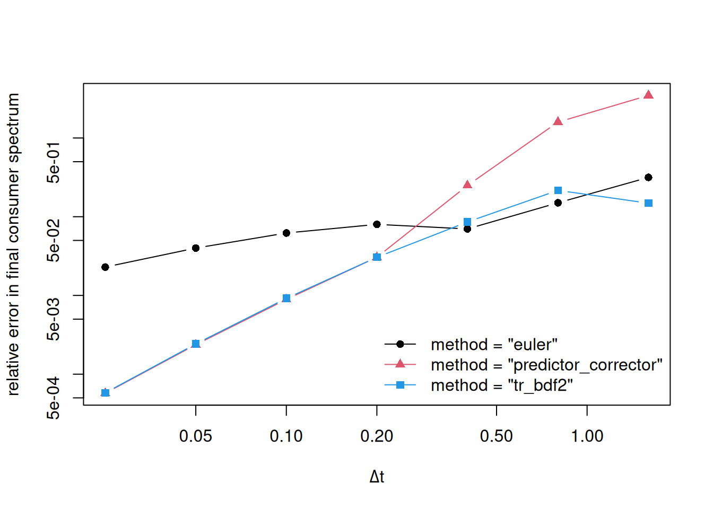

# The Numerical Scheme used in Mizer

In this vignette we explain the numerical scheme used in mizer. We will
not go into the details of the model itself, which is described in the
[model description
vignette](https://sizespectrum.org/mizer/articles/model_description.md).
We will focus on how the model is discretised and how the resulting
difference equations are solved.

## The weight grid

The model dynamics are described by partial differential equations
(PDEs) for the consumer number density \\N(w)\\ of each species and the
resource number density \\N_R(w)\\. These depend on the individual
weight \\w\\. To solve these equations numerically, we discretise the
weight axis. In this vignette we suppress the species index and write
the equations for one species; the same scheme is applied to each
species.

We choose a grid of weights \\w_1, w_2, \ldots, w_K\\. The grid is
logarithmically spaced, meaning that the ratio of consecutive weights is
constant: \\ w\_{j+1} / w_j = 10^{\Delta x} = \text{const}. \tag{1}\\
The logarithmic spacing is chosen because the weights of fish span many
orders of magnitude, from milligrams to megagrams.

This grid defines a set of bins. The \\j\\-th bin is the interval
\\\[w_j, w\_{j+1})\\. The width of the \\j\\-th bin is \\ \Delta w_j =
w\_{j+1} - w_j = w_j (10^{\Delta x} - 1). \tag{2}\\ Note that \\\Delta
w_j\\ increases with \\w_j\\, which is appropriate for a logarithmic
grid.

In the finite-volume scheme used by mizer, the discrete value \\N_j\\
represents the **average** of the number density \\N(w)\\ over the
\\j\\-th bin, \\ N_j = \frac{1}{\Delta w_j} \int\_{w_j}^{w\_{j+1}}
N(w)\\ dw, \tag{3}\\ so that the number of individuals in the \\j\\-th
bin is exactly \\N_j \Delta w_j\\. Note that \\N_j\\ is the bin average,
**not** the point value of the density at the bin boundary \\w_j\\. For
a smooth density the bin average equals the value at the **bin centre**
\\ w_j^c = \sqrt{w_j\\w\_{j+1}} \tag{4}\\ to second order in the bin
width; \\w_j^c\\ is the midpoint of the bin on the logarithmic axis. We
will need this when we discretise the diffusion.

(In the finite-volume literature the bins are usually called *cells* and
the bin boundaries *cell faces*; we keep the size-spectrum terminology
“bin” and “bin boundary” throughout.)

## The Transport Equation

The time evolution of the number density \\N(w)\\ is described by the
McKendrick-von Foerster equation with an added diffusion term: \\
\frac{\partial N}{\partial t} + \frac{\partial}{\partial w} \left( g N -
\frac{1}{2}\frac{\partial(d N)}{\partial w} \right) = -\mu N \tag{5}\\
where \\g(w)\\ is the somatic growth rate, \\d(w)\\ is the diffusion
coefficient and \\\mu(w)\\ is the total mortality rate.

We discretise this equation using a finite-volume scheme. The three
rates enter the equation in two structurally different ways, and this
dictates how we represent them on the grid (the [Point values and bin
averages](#sec-point-values) section explains why):

- the growth rate \\g\\ is a **velocity at the bin boundaries**, so we
  use its point value there, \\g_j = g(w_j)\\;
- the diffusion coefficient \\d\\ and the mortality rate \\\mu\\ are
  properties of a whole bin, so we use their **bin averages** \\d_j\\
  and \\\mu_j\\ (each equal to the value at the bin centre \\w_j^c\\ to
  second order).

## Discretisation of the Fluxes

The term inside the derivative with respect to \\w\\ is the flux
\\J(w)\\: \\ J(w) = g(w) N(w) - \frac{1}{2}\frac{\partial(d(w)
N(w))}{\partial w} \tag{6}\\ We consider the \\j\\-th size bin \\\[w_j,
w\_{j+1}\]\\. Integrating the conservation equation over this bin gives:
\\ \int\_{w_j}^{w\_{j+1}} \frac{\partial N_j}{\partial t}dw +
J(w\_{j+1}) - J(w_j) = -\int\_{w_j}^{w\_{j+1}} \mu(w) N(w) dw \tag{7}\\
Approximating the integral and dividing by \\\Delta w_j\\: \\
\frac{\partial N_j}{\partial t}+ \frac{J\_{j+1} - J_j}{\Delta w_j} =
-\mu_j N_j \tag{8}\\ where \\J_j\\ represents the flux at the boundary
\\w_j\\.

### Advective flux

The advective flux \\gN\\ at the bin boundary \\w_j\\ is the growth
velocity there, \\g_j\\, times the density there. The density at the
boundary must be reconstructed from the bin averages \\N\_{j-1}\\ and
\\N_j\\ of the two adjacent bins. The simplest reconstruction is
**upwind**: because fish grow towards larger sizes (\\g \> 0\\), take
the value from the bin below, \\ J_j^{adv} = g_j\\ N\_{j-1}. \tag{9}\\
This is only first-order accurate, because it uses a bin-centre value
(\\N\_{j-1}\\, the average of bin \\j-1\\) at the boundary, which is
half a bin away; the second-order reconstruction is the subject of
[Section 14](#sec-reducing-spatial-error). (For \\j=j\_{min}\\ this
boundary flux is the recruitment \\R\_{dd}\\.)

### Diffusive flux

The diffusive flux \\-\frac{1}{2}\frac{\partial(d N)}{\partial w}\\ at
the boundary \\w_j\\ is the derivative of the **product** \\dN\\. We
evaluate that product at the two adjacent bin centres — where the bin
averages \\d\_{j-1}N\_{j-1}\\ and \\d_j N_j\\ live — and take a central
difference across the boundary: \\ J_j^{diff} = -\frac{1}{2}\\\frac{d_j
N_j - d\_{j-1} N\_{j-1}}{w_j^c - w\_{j-1}^c}. \tag{10}\\ Because the
boundary \\w_j\\ is the midpoint (on the logarithmic axis) of the two
bin centres \\w\_{j-1}^c\\ and \\w_j^c\\, this central difference is a
genuinely second-order approximation of the derivative at \\w_j\\. Note
that the diffusion coefficient enters only *inside* the product \\dN\\:
it is sampled at the bin centres, co-located with \\N_j\\, and never
separately at the boundary. This is why \\d_j\\ is a bin average, not a
bin-boundary point value like \\g_j\\.

The total flux at boundary \\w_j\\ is therefore \\ J_j = g_j N\_{j-1} -
\frac{1}{2} \frac{d_j N_j - d\_{j-1} N\_{j-1}}{w_j^c - w\_{j-1}^c},
\tag{11}\\ and similarly at boundary \\w\_{j+1}\\, \\ J\_{j+1} =
g\_{j+1} N_j - \frac{1}{2} \frac{d\_{j+1} N\_{j+1} - d_j
N_j}{w\_{j+1}^c - w_j^c}. \tag{12}\\

## Point values and bin averages

A size-dependent rate is represented on the grid as either a
**bin-boundary point value** or a **bin average**, and which one is
correct depends on *how the rate enters the equations*, not on the rate
itself. Almost every rate is a bin average; the growth velocity is the
one exception.

**The growth velocity is a bin-boundary point value.** Growth is an
advection of mass through size, and the advective flux
\\J_j^{adv}=g_j\\N(w_j)\\ is the velocity *at the boundary* \\w_j\\
times the density carried through it. The factor that belongs to the
boundary is the velocity, so \\g_j = g(w_j)\\ is the point value there.
(The density at the boundary is a separate matter — it is reconstructed
from the neighbouring bin averages, [Equation 9](#eq-advective-flux).)

**The diffusion coefficient is a bin average.** It is tempting to treat
\\d\\ like \\g\\, but \\d\\ does not multiply a density at the boundary.
It appears only *inside* the differentiated product \\dN\\
([Equation 10](#eq-diffusive-flux)), which we sample where the density
lives — at the bin centres — and then difference across the boundary. So
\\d_j\\ is co-located with \\N_j\\ and is a **bin average**, the value
at the bin centre \\w_j^c\\. It is needed inside the bin, not on the
boundary.

**Rates integrated against the density over a bin are bin averages.**
The mortality term is, exactly, \\ \frac{1}{\Delta
w_j}\int\_{w_j}^{w\_{j+1}} \mu(w)\\N(w)\\dw. \tag{13}\\ Because \\N_j\\
is the bin average, the consistent way to factor this is \\\mu_j\\N_j\\
with the **bin-averaged** mortality \\ \mu_j = \frac{1}{\Delta
w_j}\int\_{w_j}^{w\_{j+1}} \mu(w)\\dw, \tag{14}\\ since
\\\int\_{w_j}^{w\_{j+1}}(N-N_j)\\dw = 0\\ makes the leading error cancel
and leaves an \\O(\Delta w_j^2)\\ remainder. Using the point value
\\\mu(w_j)\\ at the left bin boundary instead is the lower-order choice.
The same applies to every rate that enters inside an integral weighted
by the abundance: the fishing-mortality contribution \\\int
Q\\S(w)\\\text{effort}\\N\\dw\\, the reproductive investment \\\int
\psi(w)\\E_r(w)\\N\\dw\\, and the predation and encounter convolutions
integrated against \\N\\ (see the [FFT
vignette](https://sizespectrum.org/mizer/articles/fft.md)). Each
size-dependent factor is replaced by its bin average.

**The energy income \\e(w)\\ feeds both roles.** It sits on both sides
of the distinction. Through the somatic growth rate \\g = e - e_r\\ it
supplies the growth **velocity**, wanted as a point value at the
boundary \\w_j\\. Through the reproduction integral \\\int
\psi\\e\\N\\dw\\ it is an **integrand**, wanted as a bin average (of the
product \\\psi e\\). The same pointwise \\e(w)\\ is therefore used as a
point value for growth and bin-averaged only at its reproduction
use-site; it must **not** be pre-averaged, or the growth velocity would
be evaluated in the wrong place.

**So do the feeding level \\f(w)\\ and the search volume
\\\gamma(w)\\.** In the encounter rate
\\E_i(w)=\gamma_i(w)\int\tilde\phi_i(w/w_p)\\N^{\text{eff}}\_i(w_p)\\w_p\\dw_p\\
the search volume sits outside the integral, at the predator size where
the rate is evaluated, and the feeding level computed from \\E_i\\ feeds
the growth velocity. Both are therefore point values at \\w_j\\. But
predation turns the roles around. The predation rate on prey of size
\\w_p\\, \\ P_i(w_p) = \int
\tilde\phi_i(w/w_p)\\(1-f_i(w))\\\gamma_i(w)\\N_i(w)\\dw, \\ integrates
over **predator** size, so \\(1-f_i)\gamma_i\\ is an integrand there and
is wanted as a predator-bin average. The predation-diffusion coefficient
\\d_i(w)=(1-f_i(w))\\\gamma_i(w)\\\alpha_i^2\int\tilde\phi_i(w/w_p)\\N^{\text{eff}}\_i(w_p)\\w_p^2\\dw_p\\
needs the same factor averaged for a different reason. There
\\(1-f_i)\gamma_i\\ sits outside the integral, but \\d\\ is itself a bin
average (see above), so the whole coefficient, factor included, is
averaged over the predator bin. As with \\e\\, the stored feeding level
and search volume stay point values, and the product \\(1-f_i)\gamma_i\\
is bin-averaged only where the predation integral and the diffusion
coefficient use it. Missing this left predation mortality and predation
diffusion first order (issue \#619). The mistake was easy to make: the
same \\\gamma_i(w)\\ is correctly a point value one integral earlier.

In summary:

| Quantity | How it enters | Discrete representation |
|----|----|----|
| \\g\\ | growth velocity at the bin boundary | point value at \\w_j\\ |
| \\d\\, \\\mu\\; fishing/reproductive investments; predation and encounter integrands | bin properties (a coefficient inside \\\partial(dN)/\partial w\\, or a rate integrated against \\N\\ over a bin) | bin average over \\\[w_j, w\_{j+1}\]\\ |
| \\e\\ (energy income) | both: growth velocity *and* reproduction integrand | point value for growth; bin-averaged product \\\psi e\\ for reproduction |
| \\f\\, \\\gamma\\ (feeding level, search volume) | both: encounter and growth at the predator node *and* predation integrand over predator size and factor of the bin-averaged diffusion coefficient | point values for encounter and growth; predator-bin-averaged product \\(1-f)\gamma\\ for predation and predation diffusion |

### Applying each bin integral exactly once

Knowing *that* a factor must be bin-averaged is only half of the rule;
the other half is *where*. Each bin integral is performed in exactly one
place, and a quantity assembled out of parts must not repeat an integral
that one of its parts has already done.

The encounter rate is the clearest example. Continuously, \\ E_i(w) =
\gamma_i(w)\int \tilde\phi_i\\\left(\frac{w}{w_p}\right)
N^{\text{eff}}\_i(w_p)\\ w_p\\ dw_p , \tag{15}\\ where
\\N^{\text{eff}}\_i=\sum_j\theta\_{ij}N_j+\theta\_{iR}N_R\\ is the
interaction-weighted prey density. The smooth weight multiplying that
density is \\K(w_p)=\tilde\phi_i(w/w_p)\\w_p\\ — the kernel **and** the
mass factor \\w_p\\ together — and it is \\K\\ that has to be integrated
over the prey bin. Mizer does this once, at setup, in
[`setPredKernel()`](https://sizespectrum.org/mizer/reference/setPredKernel.md),
which stores the kernel coefficient for the grid offset \\m\\ as \\
\Phi^E_i\[m\] = \frac{\ln\beta}{\beta-1}\int_0^1
\tilde\phi_i(\beta^{\\m-s})\\\beta^{2s}\\ds . \tag{16}\\ The Jacobian
\\\beta^{2s}\\ carries the \\w_p\\dw_p\\ of the integrand, and the
division by \\\beta-1\\ *removes* the factor \\w_p\\\Delta
w_p=(\beta-1)\\w_p^2\\ that the prey vector will supply. At run time the
rate function therefore evaluates the plain sum \\ E_i(w_k) =
\gamma_i(w_k) \sum_p \Phi^E_i\[k-p\]\\ N^{\text{eff}}\_{i,p}\\
w_p\\\Delta w_p , \tag{17}\\ with the **point** value \\w_p\\ at the bin
boundary. (The [FFT
vignette](https://sizespectrum.org/mizer/articles/fft.md) derives
[Equation 16](#eq-encounter-kernel-weight) and its predation and
predation-diffusion analogues.)

The factor \\w_p\\\Delta w_p\\ in [Equation 17](#eq-encounter-sum) is
thus not a quadrature weight that has been left at first order; it is a
normalisation the kernel has already divided out. Replacing it by the
bin-averaged \\\bar w_p\\\Delta w_p\\ would apply the prey-bin integral
a second time and inflate every encounter by \\ \frac{\bar w_p}{w_p} =
\frac{w_p+w\_{p+1}}{2\\w_p} = \frac{1+\beta}{2}, \tag{18}\\ uniformly
across the grid — 9.7 % for the North Sea model, where \\\beta=1.1934\\.
That is not hypothetical: it is exactly the error
`getDiet(proportion = FALSE)` made (issue \#474). It went unnoticed for
a while precisely because the factor is uniform and so cancels in the
default `proportion = TRUE` normalisation.

The table below records which factor of each integral is bin-integrated,
and where:

| Integral | Factor that is bin-integrated | Performed in |
|----|----|----|
| encounter, predation and predation-diffusion convolutions | the kernel weight, \\\tilde\phi\\w_p\\, \\\tilde\phi\\ and \\\tilde\phi\\w_p^2\\ respectively | [`setPredKernel()`](https://sizespectrum.org/mizer/reference/setPredKernel.md), into `ft_pred_kernel_e`/`_p`/`_d` |
| predation convolution, and predation-diffusion coefficient, over the predator bin | the predator’s \\(1-f)\gamma\\ | [`mizerPredRate()`](https://sizespectrum.org/mizer/reference/mizerPredRate.md) and [`mizerDiffusion()`](https://sizespectrum.org/mizer/reference/mizerDiffusion.md), at run time, since it contains the feeding level |
| fishing sink \\\int Q\\S(w)\\\text{effort}\\N\\dw\\ | the selectivity \\S\\ | [`setFishing()`](https://sizespectrum.org/mizer/reference/setFishing.md), into `selectivity` |
| external mortality and external diffusion sinks | the power laws \\z\_{ext}w^{d}\\ and \\D\_{ext}w^{n+1}\\ | [`setExtMort()`](https://sizespectrum.org/mizer/reference/setExtMort.md), [`setExtDiffusion()`](https://sizespectrum.org/mizer/reference/setExtDiffusion.md) |
| resource semichemostat terms | the power laws \\r\_{pp}w^{n-1}\\ and \\\kappa w^{-\lambda}\\ | [`setResource()`](https://sizespectrum.org/mizer/reference/setResource.md), into `rr_pp` and `cc_pp` |
| reproduction \\\int \psi(w)\\e(w)\\N(w)\\dw\\ | the product \\\psi e\\ | [`mizerRDI()`](https://sizespectrum.org/mizer/reference/mizerRDI.md) |
| summary integrals \\\int K(w)\\N(w)\\dw\\ | the weight \\K\\: \\w\\ for biomass, \\\psi w\\ for SSB, \\F w\\ for yield, together with the size-range window | [`sizeIntegral()`](https://sizespectrum.org/mizer/reference/sizeIntegral.md), and [`getBiomass()`](https://sizespectrum.org/mizer/reference/getBiomass.md), [`getSSB()`](https://sizespectrum.org/mizer/reference/getSSB.md), [`getYield()`](https://sizespectrum.org/mizer/reference/getYield.md), … through it |

Two corollaries are worth stating explicitly.

**Never bin-average the density or the bin width.** \\N_j\\ is already a
bin average ([Equation 3](#eq-bin-average)) and \\\Delta w_j\\ is
already exact. It is only the smooth weight multiplying them that is
being approximated, so it is the only thing that gets averaged. Be
careful about what counts as the density, though. The predation
convolution takes the predator vector \\(1-f_i)\gamma_i N_i\\\Delta w\\
as its input, but only \\N_i\\ in it is a bin average. The factor
\\(1-f_i)\gamma_i\\ belongs to the smooth weight and has to be averaged
(issue \#619).

**A diagnostic that decomposes a rate must borrow that rate’s quadrature
rather than rebuild it.**
[`getDiet()`](https://sizespectrum.org/mizer/reference/getDiet.md) is
[`getEncounter()`](https://sizespectrum.org/mizer/reference/getEncounter.md)
resolved by prey species, so it uses the same kernel and the same point
prey weight \\w_p\\\Delta w_p\\; summed over prey it then reproduces
\\(1-f_i(w))\\E_i(w)\\ exactly, under both schemes.
[`getTrophicLevel()`](https://sizespectrum.org/mizer/reference/getTrophicLevel.md)
is a *ratio* of a trophic-level-weighted encounter to the plain
encounter, so its numerator and denominator must be built from the same
kernel. The exported helper
[`encounter_kernel()`](https://sizespectrum.org/mizer/reference/encounter_kernel.md)
exists for this: it returns the kernel that
[`mizerEncounter()`](https://sizespectrum.org/mizer/reference/mizerEncounter.md)
is actually using — the point-sampled kernel by default, the
bin-integrated one when `bin_average` is on, and the stored array when a
custom kernel has been set.

Note that
[`pred_kernel()`](https://sizespectrum.org/mizer/reference/setPredKernel.md)
is **not** that kernel when `bin_average` is on. It returns
\\\tilde\phi_i\\ point-sampled on the grid, which is the right object
for plotting or inspecting a feeding kernel and the form in which you
supply a custom kernel, but it is not the bin-integrated coefficient
[Equation 16](#eq-encounter-kernel-weight) that the convolution
consumes.

### Plotting follows the same distinction

A bin average \\N_j\\ does not live at the bin boundary \\w_j\\ but at
the geometric bin centre \\w^\*\_j=\sqrt{w_j\\w\_{j+1}}=w_j\sqrt\beta\\
(the log-midpoint, exact for the community spectrum \\N\propto
w^{-2}\\). So under second-order bin-averaging mizer draws bin-averaged
quantities (the abundance and the mortality/reproduction sinks) at
\\w^\*\_j\\ — a uniform half-bin shift to the right on the log axis —
while point-valued quantities (the encounter and growth-type rates) stay
on the nodes \\w_j\\. The size-resolved array classes carry a
`representation` tag recording which a quantity is, and the shift is
applied only when `second_order_w[["bin_average"]]` is set, so default
plots are unchanged.

For the `power`-weighted spectrum plots
([`plotSpectra()`](https://sizespectrum.org/mizer/reference/plotSpectra.md)
and friends) the \\w^{\text{power}}\\ factor must be evaluated where the
density value lives, so it too is taken at the bin centre: each marker
is the point \\\bigl(w^\*\_j,\\N_j\\(w^\*\_j)^{\text{power}}\bigr)\\ on
the continuous \\N(w)\\w^{\text{power}}\\ curve. (Sampling the weight at
the edge would mis-scale it by a factor \\\beta^{\text{power}/2}\\,
largest for the common \\\text{power}=2\\ Sheldon plot.) A cumulative
plot
([`plotCDF()`](https://sizespectrum.org/mizer/reference/plotCDF.md)) is
the opposite case: a CDF value is cumulative *up to a size*, a boundary
quantity, so its increments use the bin-averaged (centre-weighted)
density but the cumulative is plotted on the bin **edges**, not the
centres. Because the cumulative sum is inclusive — the sum through bin
\\k\\ is the integral over all bins up to and including bin \\k\\ — each
cumulative value is placed on that bin’s *upper* edge \\w_k+\Delta w_k\\
(in both the default and second-order schemes). This makes the inclusive
convention explicit and removes a one-bin offset that would otherwise
leave the CDF only first-order accurate in its placement.

## The `second_order_w` switch

Everything in [Section 4](#sec-point-values) describes the second-order
scheme. Which scheme a model uses depends on the defaults edition it was
created with (see
[`?defaults_edition`](https://sizespectrum.org/mizer/reference/defaults_edition.md)).
A model of edition 3 or later uses the second-order scheme unless it is
created with `second_order_w = FALSE`. Models of editions 1 and 2, which
include every model created with the default edition, keep the
historical first-order behaviour, so that existing models reproduce
their published results exactly. The choice lives in the
`second_order_w` slot, which has two independent entries.

- **`flux`** selects the reconstruction of the density at the bin
  boundary in the advective flux: `"upwind"` (first order, the default
  before edition 3), `"van_leer"` (second order, limited, keeps
  abundances non-negative, the default from edition 3) or `"centred"`
  (second order, unlimited). This affects only the transport step; see
  [Section 14](#sec-reducing-spatial-error).
- **`bin_average`** is a logical flag selecting whether the
  size-dependent factors listed in [Section 4.1](#sec-one-quadrature)
  are integrated over their bin (`TRUE`) or point-sampled at the left
  bin boundary \\w_j\\ (`FALSE`, the default before edition 3).

``` r

second_order_w(params) <- TRUE                   # both: van_leer + bin averaging
second_order_w(params) <- "centred"              # flux scheme only
second_order_w(params) <- c(bin_average = TRUE)  # bin averaging only
second_order_w(params) <- FALSE                  # both: upwind, left-edge sums
```

The two are independent because they correct different errors: `flux`
improves the time evolution of the spectrum, `bin_average` improves the
rates that drive it, and either alone leaves the other at first order.
Changing `bin_average` re-runs
[`setParams()`](https://sizespectrum.org/mizer/reference/setParams.md),
because all the arrays in the first table of
[Section 4.1](#sec-one-quadrature) are precomputed and have to be
rebuilt.

### What `bin_average` changes

Write \\\beta=w\_{j+1}/w_j\\ for the (constant) grid ratio. On a
geometric grid the exact bin average of a power law \\w^{a}\\ is \\
\overline{w^{a}}\_j = \frac{1}{\Delta w_j}\int\_{w_j}^{w\_{j+1}}
w^{a}\\dw = \frac{w\_{j+1}^{\\a+1}-w_j^{\\a+1}}{(a+1)\\\Delta w_j} =
w_j^{\\a}\\\frac{\beta^{\\a+1}-1}{(a+1)(\beta-1)}, \tag{19}\\ which
mizer computes with the internal helper
[`power_law_bin_average()`](https://sizespectrum.org/mizer/reference/power_law_bin_average.md)
and uses wherever the factor is genuinely a power law. Where it is not,
the trapezoidal average \\\bar K_j=\tfrac12(K_j+K\_{j+1})\\ is used,
which is second order for any smooth \\K\\ and exact for \\K\\ linear in
\\w\\
([`trapezoidal_bin_average()`](https://sizespectrum.org/mizer/reference/trapezoidal_bin_average.md),
reached from user code through the gated, exported
[`bin_average_weight()`](https://sizespectrum.org/mizer/reference/bin_average_weight.md)).
Where the factor is a kernel the bin integral is done by composite
quadrature at setup, [Equation 16](#eq-encounter-kernel-weight).

| Quantity | `bin_average = FALSE` | `bin_average = TRUE` |
|----|----|----|
| kernel coefficients `ft_pred_kernel_e`, `_p`, `_d` | \\\tilde\phi_i(\beta^{m})\\, point-sampled | bin-integrated, [Equation 16](#eq-encounter-kernel-weight) |
| gear selectivity | \\S(w_j)\\ | \\\frac{1}{\Delta w_j}\int S\\dw\\, by composite midpoint |
| external mortality \\z\_{ext}w^{d}\\, external diffusion \\D\_{ext}w^{n+1}\\ | point value at \\w_j\\ | exact bin average, [Equation 19](#eq-power-law-bin-average) |
| resource rate \\r\_{pp}w^{n-1}\\, capacity and initial spectrum \\\kappa w^{-\lambda}\\ | point value at \\w_j\\ | exact bin average, [Equation 19](#eq-power-law-bin-average) |
| reproduction integrand \\\psi\\e\\ | point value at \\w_j\\ | trapezoidal bin average |
| predator factor \\(1-f)\gamma\\ in the predation integral and the predation-diffusion coefficient | point value at \\w_j\\ | trapezoidal bin average over the predator bin |
| summary weights in [`sizeIntegral()`](https://sizespectrum.org/mizer/reference/sizeIntegral.md), and so in [`getBiomass()`](https://sizespectrum.org/mizer/reference/getBiomass.md), [`getN()`](https://sizespectrum.org/mizer/reference/getN.md), [`getSSB()`](https://sizespectrum.org/mizer/reference/getSSB.md), [`getYield()`](https://sizespectrum.org/mizer/reference/getYield.md), [`getYieldGear()`](https://sizespectrum.org/mizer/reference/getYieldGear.md) | \\K(w_j)\\ | trapezoidal bin average of \\K\\ |
| plotting position of a bin-averaged quantity | node \\w_j\\ | bin centre \\w_j\sqrt\beta\\ |
| growth rate \\g\\, encounter rate \\E\\, feeding level \\f\\ | point value at \\w_j\\ | **unchanged** — point value at \\w_j\\ |

The last two rows are the ones that are easy to get wrong.
[`getN()`](https://sizespectrum.org/mizer/reference/getN.md) over the
full size range is also unchanged, because its weight is \\K\equiv 1\\
and the bin average of a constant is the constant; over a restricted
size range the window itself is part of the weight, so the bin
straddling the boundary contributes only partially. And the growth-type
rates stay point values under both settings: they are boundary
velocities ([Section 4](#sec-point-values)), so bin-averaging them would
be an error, not an improvement — what improves them under `bin_average`
is that the encounter integral feeding them is now second order, not any
averaging of \\g\\ itself. The feeding level is in that last row and
also, as part of \\(1-f)\gamma\\, in the predator-factor row. This is
not a contradiction: the stored rate stays a point value, and only the
predation integral and the diffusion coefficient average the product,
exactly as reproduction averages \\\psi e\\ without changing the stored
\\e\\.

Because one setting is first order and the other second, the difference
between them is itself \\O(\Delta x)\\ and is a usable estimate of the
discretisation error of the first-order scheme: if flipping the flag
moves a result by more than you are willing to tolerate, the grid is too
coarse for that result.

### Making your own quantity second-order accurate

If you compute a diagnostic of your own — in an extension package, or in
analysis code on top of a `MizerParams` object — it falls into one of
two cases.

**Case 1: a plain integral against the abundance,** \\\int
K(w)\\N(w)\\dw\\. Discretise it as \\\sum_j \bar K_j\\N_j\\\Delta w_j\\:
keep \\N_j\\ and \\\Delta w_j\\ exactly as they are and replace the
point weight \\K(w_j)\\ by its bin average.
[`sizeIntegral()`](https://sizespectrum.org/mizer/reference/sizeIntegral.md)
does exactly this, gated on the flag, so you should not write the sum
yourself:

``` r

# biomass above 10 g, say
params <- NS_params
sizeIntegral(params, weight = w(params), min_w = 10)
```

Pass only the weight: the bin widths and the bin-averaging are applied
inside, and the size range is an argument rather than something you
impose on the grid. Because the gating happens inside, your diagnostic
follows the model it is given rather than silently disagreeing with
[`getBiomass()`](https://sizespectrum.org/mizer/reference/getBiomass.md).
If \\K\\ is a product of a size-dependent rate and a mass factor —
\\\psi(w)\\w\\, or \\F(w)\\w\\ — build the product and pass it as one
weight; the bin average of a product is not the product of the bin
averages. If you need the bin-averaged weight for something other than
an integral against the abundance, `bin_average_weight(K, params)` is
the same gating on its own, and if \\K\\ is an exact power law,
[Equation 19](#eq-power-law-bin-average) is exact rather than merely
second order.

**Case 2: a quantity built from rates mizer already computes.** Get the
rates from the rate functions
([`getEncounter()`](https://sizespectrum.org/mizer/reference/getEncounter.md),
[`getFeedingLevel()`](https://sizespectrum.org/mizer/reference/getFeedingLevel.md),
[`getPredRate()`](https://sizespectrum.org/mizer/reference/getPredRate.md),
[`getEGrowth()`](https://sizespectrum.org/mizer/reference/getEGrowth.md),
…) and do not re-derive them, because the rate functions already carry
the correct quadrature for the current setting. In particular, do not
rebuild an encounter or predation convolution out of
[`pred_kernel()`](https://sizespectrum.org/mizer/reference/setPredKernel.md)
and a hand-written prey weight: under `bin_average` that kernel is the
point-sampled one and will not agree with the rate function. If you
genuinely need the resolved convolution — as
[`getDiet()`](https://sizespectrum.org/mizer/reference/getDiet.md) and
[`getTrophicLevel()`](https://sizespectrum.org/mizer/reference/getTrophicLevel.md)
do — pair mizer’s own encounter kernel with the plain point prey weight
\\w_p\\\Delta w_p\\, and never with a bin-averaged one.

**Check the result against an identity.** Any diagnostic that decomposes
a rate should reassemble into it. For a diet-like decomposition:

``` r

params <- NS_params
second_order_w(params) <- TRUE
total <- rowSums(getDiet(params, proportion = FALSE), dims = 2)
ratio <- total / (getEncounter(params) * (1 - getFeedingLevel(params)))
range(ratio[initialN(params) > 0])
#> 1 1
```

If such a ratio comes out as a constant instead of 1, read off its
value: \\(1+\beta)/2\\ means the prey-bin quadrature has been applied
twice, and \\2/(1+\beta)\\ means it is missing. The value is easy to
recognise, since \\\beta\\ is just
`w_full(params)[2] / w_full(params)[1]`.

## Semi-Implicit Time Discretisation

With the diffusion term, an explicit time discretisation would require a
very small time step for stability (\\\Delta t \sim \Delta w^2\\).
Therefore, we use a semi-implicit scheme where the densities \\N\\ are
evaluated at time \\t+1\\, but the rates (\\g\\, \\\mu\\, \\d\\) are
evaluated at time \\t\\. Using a fully implicit scheme would require
solving a nonlinear system at each time step, which is more
computationally expensive. Thus, the discretised equation becomes: \\
\frac{N_j^{t+1} - N_j^t}{\Delta t} + \frac{1}{\Delta w_j} \left(
J\_{j+1}^{t+1} - J_j^{t+1} \right) = -\mu_j N_j^{t+1} \tag{20}\\ where
the fluxes \\J_j^{t+1}\\ are calculated using the densities at time
\\t+1\\ but the rates at time \\t\\. To simplify the notation we will
drop the explicit time indices on the rates, but it is important to
remember that they are evaluated at time \\t\\. Writing \\\Delta w_j^c =
w\_{j+1}^c - w_j^c\\ for the spacing between adjacent bin centres, the
fluxes at time \\t+1\\ are: \\ \begin{aligned} J\_{j+1}^{t+1} &=
g\_{j+1} N_j^{t+1} - \frac{1}{2} \frac{d\_{j+1} N\_{j+1}^{t+1} - d_j
N_j^{t+1}}{\Delta w_j^c} \\ J_j^{t+1} &= g_j N\_{j-1}^{t+1} -
\frac{1}{2} \frac{d_j N_j^{t+1} - d\_{j-1} N\_{j-1}^{t+1}}{\Delta
w\_{j-1}^c}. \end{aligned} \tag{21}\\ This leads to a linear system of
the form: \\ A_j N\_{j-1}^{t+1} + B_j N_j^{t+1} + C_j N\_{j+1}^{t+1} =
S_j \tag{22}\\ where \\S_j = N_j^t\\. This is a **tridiagonal system**
for each species, which can be solved efficiently (e.g., using the
Thomas algorithm).

The coefficients are: \\ \begin{aligned} A_j &= -\frac{\Delta t}{\Delta
w_j} \left( g_j + \frac{1}{2} \frac{d\_{j-1}}{\Delta w\_{j-1}^c} \right)
\\ C_j &= -\frac{\Delta t}{\Delta w_j} \left( \frac{1}{2}
\frac{d\_{j+1}}{\Delta w_j^c} \right) \\ B_j &= 1 + \Delta t \mu_j +
\frac{\Delta t}{\Delta w_j} \left( g\_{j+1} + \frac{1}{2}
\frac{d_j}{\Delta w_j^c} + \frac{1}{2} \frac{d_j}{\Delta w\_{j-1}^c}
\right) \end{aligned} \tag{23}\\ The advective velocity is taken at each
bin boundary (\\g_j\\ at the lower boundary of bin \\j\\, \\g\_{j+1}\\
at the upper one), and the diffusion differences the bin-averaged
products \\d_jN_j\\ between bin centres — exactly
[Equation 21](#eq-fluxes-tp1).

## Boundary Conditions

**At the smallest size (\\j=j\_{min}\\):** The flux entering the grid is
determined by recruitment: \\ J\_{j\_{min}}^{t+1} = R\_{dd} \tag{24}\\
(We assume diffusive flux at the lower boundary is negligible or
incorporated into \\R\_{dd}\\). The equation for the first bin becomes:
\\ \frac{N\_{j\_{min}}^{t+1} - N\_{j\_{min}}^t}{\Delta t} +
\frac{J\_{j\_{min}+1}^{t+1} - R\_{dd}}{\Delta w\_{j\_{min}}} =
-\mu\_{j\_{min}} N\_{j\_{min}}^{t+1} \tag{25}\\ This involves
\\N\_{j\_{min}}^{t+1}\\ and \\N\_{j\_{min}+1}^{t+1}\\. Comparing this to
the general discretised equation translates to modifying the first row
(\\j=j\_{min}\\) of our tri-diagonal matrices:

- The \\j\_{min}-1\\ term does not exist, so \\A\_{j\_{min}} = 0\\.
- The upward diffusion term from below the boundary is omitted, so
  \\B\_{j\_{min}}\\ does not have the \\\frac{1}{2}
  \frac{d\_{j\_{min}}}{\Delta w\_{j\_{min}-1}^c}\\ component: \\
  B\_{j\_{min}} = 1 + \Delta t \mu\_{j\_{min}} + \frac{\Delta t}{\Delta
  w\_{j\_{min}}} \left( g\_{j\_{min}+1} + \frac{1}{2}
  \frac{d\_{j\_{min}}}{\Delta w\_{j\_{min}}^c} \right) \tag{26}\\
- The coefficient \\C\_{j\_{min}}\\ remains unchanged from the general
  formula.
- The recruitment flux enters as a source term, so it is added to the
  right-hand side \\S\_{j\_{min}}\\: \\ S\_{j\_{min}} =
  N\_{j\_{min}}^t + \frac{\Delta t}{\Delta w\_{j\_{min}}} R\_{dd}
  \tag{27}\\

(Additionally, for any size classes below the recruitment size \\j \<
j\_{min}\\, we set all coefficients in the matrices \\A\\, \\B\\, \\C\\
and vector \\S\\ to \\0\\ to avoid any dynamics in that range).

**At the largest size (\\j=j\_{max}\\):** The transport solvers impose
an absorbing boundary at the top retained size class, with the legacy
Euler exception described below. The density above this support is held
at zero: \\ N\_{j}^{t+1} = 0 \quad\text{for } j \> j\_{max}. \tag{28}\\
Any flux that reaches the upper boundary \\w\_{j\_{max}+1}\\ is simply
lost — the boundary absorbs it rather than reflecting it back. One could
interpret this as an infinite senescent mortality that removes every
fish reaching \\w\_{max}\\, but a better approach is to choose
\\w\_{max}\\ **large enough that the flux reaching the boundary is
already negligible**: fish should grow to their asymptotic size and die
of natural mortality well before \\w\_{max}\\, so the truncation has no
material effect on the dynamics.

Note that \\w\_{max}\\ is distinct from \\w\_{repro\\max}\\, the size at
which a typical mature individual diverts all available energy into
reproduction. Somatic growth slows around \\w\_{repro\\max}\\, but not
instantaneously — the maturity ogive is gradual, diffusion lets some
individuals grow beyond it, and at \\w\_{repro\\max}\\ the growth rate
need not vanish entirely. Choosing \\w\_{max}\\ sufficiently larger than
\\w\_{repro\\max}\\ ensures that both the density and the flux have
decayed to negligible levels before the boundary is reached.

The top retained class \\j\_{max}\\ depends on the scheme, because the
two schemes place the advective inflow differently. With \\w\_{max\\idx}
= \max\\j : w_j \le w\_{max}\\\\:

- the first-order upwind scheme feeds class \\j\\ from the growth of the
  class below, \\g(w\_{j-1})\\, so the class just above the one
  containing \\w\_{max}\\ can still carry advected density; here
  \\j\_{max} = w\_{max\\idx} + 1\\. This reproduces the long-standing
  mizer behaviour exactly;
- the second-order scheme reconstructs the flux at a class’s own lower
  face, \\g(w_j)\\, so its support ends one class lower, \\j\_{max} =
  w\_{max\\idx}\\.

To impose [Equation 28](#eq-upper-bc-zero), the term \\C\_{j\_{max}}\\
multiplying \\N\_{j\_{max}+1}^{t+1}\\ is dropped (\\C\_{j\_{max}} =
0\\), exactly as at the lower boundary. This sets the back-substitution
coefficient at \\j\_{max}\\ to zero, so the retained spectrum up to
\\j\_{max}\\ is solved independently of the classes above it; those
classes are then set to zero after the tridiagonal solve. The
coefficients \\A\_{j\_{max}}\\ and \\B\_{j\_{max}}\\ use the standard
formulas; in particular \\B\_{j\_{max}}\\ keeps its advective outflow
term, which carries whatever (possibly non-zero) growth flux leaves the
grid at the truncation boundary.

Without diffusion the truncation reproduces the untruncated mizer
behaviour when the classes above \\j\_{max}\\ receive no advective
inflow once \\w\_{max}\\ is past the size where growth has died away, so
they are already zero and imposing [Equation 28](#eq-upper-bc-zero)
changes nothing. With diffusion, density would otherwise leak to sizes
above \\w\_{max}\\; the boundary condition holds it at zero there
instead. Because the location of \\j\_{max}\\ is fixed by \\w\_{max}\\
and the scheme — not by the densities — it is the same at every time
step and at the steady state. The steady-state solver
(`solver = "newton"`) solves on this support.

The legacy upwind Euler step without diffusion is an exception: it does
not explicitly clear the classes above \\j\_{max}\\. They stay empty if
they have no inflow, as in the usual case where growth has died away
before the boundary. Custom growth rates can instead fill them, and an
initially populated tail can decay there. Euler uses this legacy path
only when the flux scheme is upwind and the evaluated diffusion is
nowhere positive across all species. The other transport paths clear the
excluded classes after each step. Thus a truncated steady state need not
be a fixed point of the legacy path when custom growth carries fish
beyond its support.

Euler solver selection and the drift diagnostic share the same boundary
rule. It uses the evaluated diffusion at the current state, including
custom diffusion functions, across all species and sizes. Positive
diffusion in one species therefore selects the boundary that holds
excluded bins at zero for every species. Projection checks the rule at
each Euler step, including each internal step when subcycling, so a
changing diffusion rate can change the selected path. The quadrature
setting does not directly enter this decision. Predictor-corrector and
TR-BDF2 always clear the excluded tail. The drift diagnostic retains
Euler’s boundary convention even when projecting with those methods.

### Drift diagnostics at the upper boundary

[`getSteadyResidual()`](https://sizespectrum.org/mizer/reference/getSteadyResidual.md)
and the drift checks used by
[`isSteady()`](https://sizespectrum.org/mizer/reference/isSteady.md),
[`summary()`](https://sizespectrum.org/mizer/reference/summary.md) and
settling routines use the consumer equations on the retained support.
With a higher-order flux, or when the evaluated diffusion is positive
anywhere in the model, an empty excluded class contributes zero:
projection holds its density at zero, so transport into it must not be
counted as an increase in abundance. Only classes with exactly zero
density above \\j\_{max}\\ are excluded from the diagnostic. Empty
retained classes can still fill and contribute to the drift.

This correction preserves the outgoing loss from the last retained
class: \\ \frac{dN\_{j\_{max}}}{dt} = \frac{J\_{j\_{max}} -
J\_{j\_{max}+1}}{\Delta w\_{j\_{max}}} - \mu\_{j\_{max}} N\_{j\_{max}}.
\tag{29}\\ In particular, removing the contribution from an excluded
receiving class does not remove the term \\-J\_{j\_{max}+1}/\Delta
w\_{j\_{max}}\\ from this equation. Species biomass drift uses the same
size-integration weights as biomass, under either quadrature scheme. A
small biomass drift indicates little net biomass change in the truncated
model; it does not establish that loss at the truncation boundary is
negligible, or rule out changes within its size spectrum.

Two limitations are retained for compatibility. First, with upwind flux
and no positive diffusion, inflow into empty excluded classes remains in
the diagnostic because the legacy Euler path can fill them. Second,
populated excluded classes retain their algebraic rates, including
mortality decay. A transport step that clears such a populated tail
removes a finite abundance immediately, so that change has no finite
instantaneous derivative and is not represented by this diagnostic. The
correction changes neither projection nor the algebraic equations used
by the Newton solver.

## Numerical Diffusion

The upwind scheme used for the advective term introduces numerical
diffusion. This is a well-known property of first-order upwind schemes.
We can estimate the magnitude of this diffusion by expanding the
discretised term using a Taylor series.

The discretised equation for the transport (advection only, with
constant rates for simplicity) is: \\ \frac{N_j^{t+1} - N_j^t}{\Delta
t} + g \frac{N_j^{t+1} - N\_{j-1}^{t+1}}{\Delta w} = 0 \tag{30}\\
Expanding \\N(w, t)\\ around \\(w_j, t+\Delta t)\\ leads to the
following leading order error terms: \\ \frac{\partial N}{\partial t} +
g \frac{\partial N}{\partial w} = \frac{g \Delta w}{2} \left( 1 +
\frac{g \Delta t}{\Delta w} \right) \frac{\partial^2 N}{\partial w^2}
\tag{31}\\ The coefficient of the second derivative represents the
numerical diffusivity: \\ D\_{num} = \frac{g \Delta w}{2} (1 + C)
\tag{32}\\ where \\C = \frac{g \Delta t}{\Delta w}\\ is the
Courant-Friedrichs-Lewy (CFL) number. Comparing this to the Mizer
diffusion equation form (where the diffusion term is
\\\frac{\partial}{\partial w} ( \frac{1}{2} \frac{\partial (D
N)}{\partial w} )\\), the effective diffusion parameter is: \\
d\_{num}(w) \approx g(w) \Delta w (1 + C(w)) \tag{33}\\ Since \\\Delta w
\approx w \ln(\beta)\\, this is: \\ d\_{num}(w) \approx g(w) w
\ln(\beta) \left( 1 + \frac{g(w) \Delta t}{w \ln(\beta)} \right) = g(w)
w \ln(\beta) + g(w)^2 \Delta t \tag{34}\\ This means the numerical
scheme behaves as if there is a diffusion \\d\_{num}\\. This numerical
diffusion has two components: one from spatial discretisation (scaling
with \\\Delta w\\) and one from time stepping (scaling with \\\Delta
t\\).

## Order of Accuracy

The scheme is first order in time. To see this, expand the backward
difference around the new time level: \\ \frac{N_j^{t+1} - N_j^t}{\Delta
t} = \frac{\partial N_j}{\partial t}(t+\Delta t) - \frac{\Delta
t}{2}\frac{\partial^2 N_j}{\partial t^2}(t+\Delta t) + O(\Delta t^2).
\tag{35}\\ Thus the time discretisation has a truncation error of order
\\O(\Delta t)\\. Evaluating the rates \\g\\, \\d\\ and \\\mu\\ at time
\\t\\ instead of \\t+1\\ also introduces only an \\O(\Delta t)\\ error,
provided the rates vary smoothly in time. The semi-implicit scheme is
therefore first order in \\\Delta t\\.

For the spatial discretisation, the upwind advective flux is the
limiting term. For smooth \\gN\\, \\ \frac{(gN)\_j - (gN)\_{j-1}}{\Delta
w\_{j-1}} = \frac{\partial(gN)}{\partial w}(w_j) - \frac{\Delta
w\_{j-1}}{2}\frac{\partial^2(gN)}{\partial w^2}(w_j) + O(\Delta
w\_{j-1}^2), \tag{36}\\ so the upwind advective reconstruction has an
\\O(\Delta w_j)\\ spatial truncation error. The diffusive flux, being a
central difference of the bin-averaged products between bin centres
([Equation 10](#eq-diffusive-flux)), is second order, and the
bin-averaged sinks are second order too; so on the upwind scheme the
spatial order is set entirely by the upwind advective reconstruction.
Replacing it by a higher-order reconstruction
([Section 14](#sec-reducing-spatial-error)) removes this last \\O(\Delta
w_j)\\ error.

On the logarithmic grid, writing \\\beta = w\_{j+1}/w_j\\, we have \\
\Delta w_j = w_j(\beta - 1) = w_j\left(\log\beta +
O((\log\beta)^2)\right). \tag{37}\\ Thus, at fixed body size \\w_j\\,
first order in \\\Delta w_j\\ is equivalently first order in
\\\log\beta\\. Combining the time and space errors, the scheme is \\
O(\Delta t) + O(\Delta w_j) \tag{38}\\ locally, or \\O(\Delta t +
\log\beta)\\ on the logarithmic grid.

## Predictor-Corrector Time Stepping

A straightforward way to make the time discretisation second order is to
combine a predictor step for the rates with a Crank-Nicolson corrector
for the densities. The aim is to keep the useful property that, once the
rates are fixed, the density update is still a tridiagonal linear solve.

Let \\L(r)\\ denote the spatial operator for the consumer spectrum when
the rates \\ r = (g, d, \mu) \tag{39}\\ are fixed, and let
\\q(R\_{dd})\\ denote the recruitment source at the lower boundary. The
semi-implicit Euler method used above can be written schematically as \\
\frac{N^{t+1} - N^t}{\Delta t} = L(r^t) N^{t+1} + q(R\_{dd}^t).
\tag{40}\\ This is first order because the rates and recruitment are
only evaluated at the start of the time step.

The predictor-corrector method proceeds as follows:

1.  **Predict:** Use the existing semi-implicit Euler scheme with rates
    \\r^t\\ to get a provisional value \\\hat{N}^{t+1}\\.
2.  **Recalculate rates:** Evaluate provisional end-of-step rates
    \\\hat{r}^{t+1}\\ and recruitment \\\hat{R}\_{dd}^{t+1}\\ from
    \\\hat{N}^{t+1}\\.
3.  **Approximate midpoint rates:** Use \\ r^{t+1/2} =
    \frac{1}{2}\left(r^t + \hat{r}^{t+1}\right), \tag{41}\\ so in
    particular \\ g_j^{t+1/2} = \frac{1}{2}\left(g_j^t +
    \hat{g}\_j^{t+1}\right), \quad d_j^{t+1/2} =
    \frac{1}{2}\left(d_j^t + \hat{d}\_j^{t+1}\right), \quad
    \mu_j^{t+1/2} = \frac{1}{2}\left(\mu_j^t +
    \hat{\mu}\_j^{t+1}\right). \tag{42}\\ The recruitment flux is
    averaged in the same way: \\ R\_{dd}^{t+1/2} =
    \frac{1}{2}\left(R\_{dd}^t + \hat{R}\_{dd}^{t+1}\right). \tag{43}\\
4.  **Correct:** Do a Crank-Nicolson update using the midpoint rates: \\
    \frac{N^{t+1} - N^t}{\Delta t} = \frac{1}{2}\left(L(r^{t+1/2})N^t +
    L(r^{t+1/2})N^{t+1}\right) + q(R\_{dd}^{t+1/2}). \tag{44}\\

In flux form, the corrector equation for an interior bin is \\
\begin{aligned} \frac{N_j^{t+1} - N_j^t}{\Delta t} &+ \frac{1}{2\Delta
w_j} \left\[ \left(J\_{j+1}^{t+1} - J_j^{t+1}\right) +
\left(J\_{j+1}^t - J_j^t\right) \right\] \\ &=
-\frac{1}{2}\mu_j^{t+1/2}\left(N_j^{t+1} + N_j^t\right), \end{aligned}
\tag{45}\\ where all fluxes use the midpoint rates. For example, \\
J_j^{t+1} = g_j^{t+1/2} N\_{j-1}^{t+1} - \frac{1}{2}\frac{ d_j^{t+1/2}
N_j^{t+1} - d\_{j-1}^{t+1/2} N\_{j-1}^{t+1} }{\Delta w\_{j-1}^c},
\tag{46}\\ and \\J_j^t\\ is the same expression with \\N^t\\ instead of
\\N^{t+1}\\. The lower boundary uses \\ J\_{j\_{min}}^{t+1} =
J\_{j\_{min}}^t = R\_{dd}^{t+1/2}. \tag{47}\\

Because the midpoint rates are fixed during the corrector step, the
unknowns still enter only through \\N\_{j-1}^{t+1}\\, \\N_j^{t+1}\\ and
\\N\_{j+1}^{t+1}\\. The corrector is therefore again a tridiagonal
system. The difference from the first-order scheme is that the old-time
fluxes and mortality terms are moved to the right-hand side, while the
new-time terms supply the tridiagonal matrix.

If the provisional predictor has the usual one-step accuracy, the
averaged rates approximate the true midpoint rates to second order. The
Crank-Nicolson corrector is then second order in \\\Delta t\\ for smooth
solutions: \\ \text{time error} = O(\Delta t^2). \tag{48}\\ This does
not change the spatial order of the scheme, which remains first order
because of the upwind advective flux. The combined order would therefore
be \\ O(\Delta t^2) + O(\Delta w_j), \tag{49}\\ or \\O(\Delta t^2 +
\log\beta)\\ on the logarithmic grid.

There are two practical cautions. First, this doubles the number of rate
evaluations per time step. Second, Crank-Nicolson-type methods are less
damping than backward Euler, so for large time steps they can show
oscillations even when they are formally stable. Positivity and
robustness would therefore need to be checked carefully before using
this as the default time stepper.

## TR-BDF2 Time Stepping

The oscillations of the Crank-Nicolson corrector are a consequence of
its stability function. For the scalar test problem \\N' = \lambda N\\
the corrector multiplies the solution by \\ R\_{CN}(z) = \frac{1 +
z/2}{1 - z/2}, \qquad z = \lambda\\\Delta t, \tag{50}\\ and for a
strongly damped mode (\\\lambda\\ real and very negative) \\R\_{CN}(z)
\to -1\\ as \\z \to -\infty\\. Such modes are therefore barely damped
and flip sign every step. This is the ringing seen at large \\\Delta
t\\, and it is driven most strongly by the non-smooth recruitment
boundary at \\w\_{min}\\. Crank-Nicolson is *A-stable* but not
*L-stable*: it does not satisfy \\R(z) \to 0\\ as \\z \to -\infty\\.

The **TR-BDF2** method, selected with `method = "tr_bdf2"`, keeps
second-order accuracy but is *L-stable*, so the stiff modes are damped
rather than ringing. It is a one-step, two-stage method. Writing the
frozen-rate spatial operator and recruitment source as \\L\\ and \\q\\
(as above), and using a stage fraction \\\gamma\\, one step from \\N^t\\
to \\N^{t+1}\\ is

1.  **Trapezoidal (TR) stage** over \\\[t, t+\gamma\Delta t\]\\: \\
    \frac{N^{t+\gamma} - N^t}{\gamma\Delta t} = \tfrac{1}{2}\left(L
    N^t + L N^{t+\gamma}\right) + q. \tag{51}\\
2.  **Backward-differentiation (BDF2) stage** over the whole step, using
    \\N^t\\, \\N^{t+\gamma}\\ and \\N^{t+1}\\: \\ N^{t+1} =
    \frac{1}{\gamma(2-\gamma)}N^{t+\gamma} -
    \frac{(1-\gamma)^2}{\gamma(2-\gamma)}N^t +
    \frac{1-\gamma}{2-\gamma}\\\Delta t\left(L N^{t+1} + q\right).
    \tag{52}\\

The standard choice is \\ \gamma = 2 - \sqrt{2}, \tag{53}\\ which makes
the method L-stable and, crucially for the implementation, makes the two
stages share the **same** implicit coefficient. The TR stage implicitly
multiplies \\L\\ by \\\gamma\Delta t/2\\ and the BDF2 stage by
\\(1-\gamma)/(2-\gamma)\\\Delta t\\, and for \\\gamma = 2-\sqrt 2\\ both
equal \\ \alpha\\\Delta t, \qquad \alpha = \frac{\gamma}{2} = 1 -
\frac{1}{\sqrt 2}. \tag{54}\\ Each stage is therefore a solve against
the same matrix \\I - \alpha\Delta t\\L\\, which is exactly the
tridiagonal operator \\\tt{get\\transport\\coefs()}\\ builds at time
step \\\alpha\Delta t\\. The matrix is assembled once and the BDF2 stage
reuses it; only the right-hand sides differ. Writing \\c_1 = (\sqrt 2 +
1)/2\\ and \\c_0 = (\sqrt 2 - 1)/2\\ (with \\c_1 - c_0 = 1\\), the
right-hand sides are \\ \begin{aligned} S^{TR} &= 2N^t - (I -
\alpha\Delta t\\L)\\N^t + \gamma\Delta t\\ q, \\ S^{BDF2} &= c_1
N^{t+\gamma} - c_0 N^t + \alpha\Delta t\\ q. \end{aligned} \tag{55}\\
The first of these is the Crank-Nicolson right-hand side over the
sub-step \\\gamma\Delta t\\, so the TR stage reuses the existing
corrector assembly.

The nonlinear rates are treated exactly as in the predictor-corrector
method: a provisional Euler predictor gives end-of-step rates, these are
averaged with the start-of-step rates to obtain second-order midpoint
rates, and the frozen operator \\L\\ uses those midpoint rates. The
result is second order in \\\Delta t\\ for the full nonlinear dynamics
while remaining L-stable, at the cost of one predictor solve, two stage
solves and one rate recalculation per step.

This last point carries a proviso that applies to all three methods but
bites hardest here, because it is what the extra order is bought with.
Averaging the start-of-step and predicted end-of-step rates approximates
the true midpoint rate to second order only if the rates vary
**smoothly** along the trajectory. A rate that jumps as a function of
the densities — a custom rate function that switches on a threshold,
registered with
[`setRateFunction()`](https://sizespectrum.org/mizer/reference/setRateFunction.md)
— violates this. On a step in which the threshold is crossed, the honest
step-average weights the two branches by the fraction of the step spent
on each side, whereas the scheme weights them \\\tfrac12\\ and
\\\tfrac12\\, or picks one branch outright if both samples land on the
same side. The error is then proportional to the size of the jump, and
L-stability does not help: it damps stiff modes of the frozen operator
\\L\\, whereas the offending mode lives in the rates, which are held
constant across both stage solves. The [discontinuous rates
vignette](https://sizespectrum.org/mizer/articles/discontinuous_rates.md)
works through the consequences and the remedy.

At a steady state the argument of the previous section applies
unchanged: with \\N^t = N^{t+\gamma} = N^{t+1} = N^\*\\ both stages
reduce to \\L N^\* + q = 0\\. TR-BDF2 therefore has the same fixed point
as the Euler and predictor-corrector methods and only changes the
transient path.

## Accuracy comparison

This vignette compares the first-order consumer density update, selected
with `method = "euler"`, with the two second-order updates selected with
`method = "predictor_corrector"` and `method = "tr_bdf2"`, on the North
Sea example model `NS_params`.

The comparison is intentionally modest. It is meant as a reproducible
smoke test for speed and time-step sensitivity, not as a comprehensive
benchmark.

We compare final consumer spectra against a smaller-time-step reference
solution from the TR-BDF2 method. Because all methods use the same
spatial discretisation, this test is only about the time discretisation
error on the fixed `NS_params` weight grid.

Code

``` r

t_max <- 8
dt_values <- c(1.6, 0.8,0.4, 0.2, 0.1, 0.05, 0.025)
reference_dt <- 0.4 / 2^6

params <- NS_params
initial_effort(params) <- 4

relative_l2_error <- function(x, reference) {
    x_final <- finalN(x)
    reference_final <- finalN(reference)
    sqrt(sum((x_final - reference_final)^2)) / sqrt(sum(reference_final^2))
}

reference <- project(
    params,
    dt = reference_dt,
    t_max = t_max,
    method = "tr_bdf2"
)

accuracy <- do.call(rbind, lapply(dt_values, function(dt) {
    euler <- project(params, dt = dt, t_max = t_max, t_save = t_max,
                     method = "euler")
    pc <- project(params, dt = dt, t_max = t_max, t_save = t_max,
                  method = "predictor_corrector")
    trbdf2 <- project(params, dt = dt, t_max = t_max, t_save = t_max,
                      method = "tr_bdf2")

    data.frame(
        dt = dt,
        euler_error = relative_l2_error(euler, reference),
        predictor_corrector_error = relative_l2_error(pc, reference),
        tr_bdf2_error = relative_l2_error(trbdf2, reference)
    )
}))

accuracy
```

         dt euler_error predictor_corrector_error tr_bdf2_error
    1 1.600  0.31596647              3.4780282823  0.1485219020
    2 0.800  0.15030919              1.5930749272  0.2161710472
    3 0.400  0.06998422              0.2491341164  0.0858144631
    4 0.200  0.07996242              0.0305651825  0.0305334237
    5 0.100  0.06213206              0.0089017443  0.0091873340
    6 0.050  0.03998051              0.0023680430  0.0024242194
    7 0.025  0.02294875              0.0005722933  0.0005797011

Code

``` r

plot(
    euler_error ~ dt,
    data = accuracy,
    log = "xy",
    type = "b",
    pch = 16,
    xlab = expression(Delta * t),
    ylab = "relative error in final consumer spectrum",
    ylim = range(accuracy$euler_error, accuracy$predictor_corrector_error,
                 accuracy$tr_bdf2_error)
)
lines(
    predictor_corrector_error ~ dt,
    data = accuracy,
    type = "b",
    pch = 17,
    col = 2
)
lines(
    tr_bdf2_error ~ dt,
    data = accuracy,
    type = "b",
    pch = 15,
    col = 4
)
legend(
    "bottomright",
    legend = c('method = "euler"', 'method = "predictor_corrector"',
               'method = "tr_bdf2"'),
    pch = c(16, 17, 15),
    col = c(1, 2, 4),
    lty = 1,
    bty = "n"
)
```



### Speed

The second-order methods do roughly twice the work per time step. The
predictor-corrector method performs one predictor solve and then
recalculates the rates before doing the corrector solve. TR-BDF2
performs the same predictor solve and rate recalculation, and then two
stage solves against the shared operator, so it is marginally more
expensive than the predictor-corrector method per step.

### The resource update

Under the second-order methods the resource is also advanced to second
order. The resource mortality \\\mu_R\\ depends on the consumer
densities, so evaluating it only at the start of the step would make the
resource update first order and cap the overall accuracy. Instead, the
predictor step is used to form the same midpoint rates \\r^{t+1/2}\\
that drive the consumer corrector, and the resource is then advanced
with the midpoint resource mortality \\ \mu_R^{t+1/2} =
\tfrac{1}{2}\left(\mu_R^t + \hat\mu_R^{t+1}\right). \tag{56}\\ At a
steady state \\r^t = \hat r^{t+1} = r^{t+1/2}\\, so the resource
corrector reproduces the predictor and the steady state is unchanged.
With the default semi-chemostat resource dynamics, which already use the
analytic solution for fixed mortality, the remaining resource error is
small, but the midpoint mortality removes the first-order time-stepping
component. The `euler` method keeps the first-order resource update.

### Interpretation

On short runs the second-order methods may not always show a clean
second-order convergence slope because the comparison is affected by the
fixed spatial grid, nonlinear rate feedbacks and ordinary timing noise.
TR-BDF2 typically shows the cleanest slope of the three because, being
L-stable, it does not ring at the larger time steps.

Because the predictor-corrector method is more expensive per time step,
the relevant comparison is between the Euler method at a given `dt` and
the predictor-corrector method at twice the `dt` so that both have
similar run times.

## Numerical Diffusion for the Predictor-Corrector Method

The predictor-corrector method uses the same upwind approximation in
size as the first-order method, so it still has numerical diffusion.
However, the Crank-Nicolson corrector changes the time-stepping
contribution to that diffusion.

To see this, again consider the advection-only problem with constant
growth rate \\g\\ on a locally uniform grid with spacing \\\Delta w\\:
\\ \frac{\partial N}{\partial t} + g\frac{\partial N}{\partial w} = 0.
\tag{57}\\ With fixed rates, the corrector step reduces to the
Crank-Nicolson upwind scheme \\ \frac{N_j^{t+1} - N_j^t}{\Delta t} +
\frac{g}{2} \left\[ \frac{N_j^{t+1} - N\_{j-1}^{t+1}}{\Delta w} +
\frac{N_j^t - N\_{j-1}^t}{\Delta w} \right\] = 0. \tag{58}\\

Expand this equation about the midpoint \\(w_j, t + \Delta t / 2)\\. The
centred time difference gives \\ \frac{N_j^{t+1} - N_j^t}{\Delta t} =
\frac{\partial N}{\partial t} + O(\Delta t^2). \tag{59}\\ The average of
the two upwind spatial differences gives \\ \frac{1}{2} \left\[
\frac{N_j^{t+1} - N\_{j-1}^{t+1}}{\Delta w} + \frac{N_j^t -
N\_{j-1}^t}{\Delta w} \right\] = \frac{\partial N}{\partial w} -
\frac{\Delta w}{2}\frac{\partial^2 N}{\partial w^2} + O(\Delta w^2) +
O(\Delta t^2). \tag{60}\\ Substituting these expansions into the scheme
gives the modified equation \\ \frac{\partial N}{\partial t} +
g\frac{\partial N}{\partial w} = \frac{g\Delta w}{2}\frac{\partial^2
N}{\partial w^2} + O(\Delta w^2) + O(\Delta t^2). \tag{61}\\ Thus the
numerical diffusivity in the usual advection-diffusion form is \\
D\_{num}^{PC} = \frac{g\Delta w}{2}. \tag{62}\\ In the mizer notation,
where the diffusion term is written with a factor \\1/2\\ inside the
flux, this corresponds to the effective diffusion parameter \\
d\_{num}^{PC}(w) \approx g(w)\Delta w. \tag{63}\\ On the logarithmic
grid this becomes \\ d\_{num}^{PC}(w) \approx g(w)w\log\beta. \tag{64}\\

Compared with the first-order semi-implicit scheme, \\
d\_{num}^{Euler}(w) \approx g(w)\Delta w + g(w)^2\Delta t, \tag{65}\\
the predictor-corrector method removes the leading artificial diffusion
proportional to \\\Delta t\\. The remaining numerical diffusion is the
spatial upwind diffusion, proportional to \\\Delta w\\ or equivalently
to \\\log\beta\\ on the logarithmic grid. This is why decreasing
\\\Delta t\\ eventually stops improving the error much: once the
time-stepping error is small, the spatial upwind error and other fixed
discretisation errors dominate.

## Reducing the Spatial Error: a Higher-Order Reconstruction

In the scheme above only one ingredient is first order: the **upwind
reconstruction** of the boundary density in the advective flux
([Equation 9](#eq-advective-flux)). Using the bin-below average
\\N\_{j-1}\\ as the density at the boundary \\w_j\\ introduces the
numerical diffusion \\d\_{num}\approx g(w)\\w\log\beta\\ derived
earlier, and on a coarse logarithmic grid (a few hundred bins over many
decades) it is not small. It is the one spatial error the second-order
time methods *cannot* remove. The `flux` entry of the `second_order_w`
slot replaces the upwind reconstruction by a higher-order one. Because
the choice changes the discrete steady state it lives in the params
object rather than being a
[`project()`](https://sizespectrum.org/mizer/reference/project.md)
argument.

### The reconstruction

The boundary \\w_j\\ is the midpoint, on the logarithmic axis, of the
two bin centres \\w\_{j-1}^c\\ and \\w_j^c\\, so a second-order estimate
of the density there is the average of the two bin averages. We write
the general reconstruction with a weight \\\chi_j\\, \\ N(w_j) \approx
N\_{j-1} + \tfrac12\\\chi_j\\(N_j - N\_{j-1}), \tag{66}\\ which is pure
upwind (\\N\_{j-1}\\) when \\\chi_j = 0\\ and the centred value
\\\tfrac12(N\_{j-1}+N_j)\\ when \\\chi_j = 1\\. The advective flux
becomes \\ J_j^{adv} = g_j\bigl\[N\_{j-1} + \tfrac12\\\chi_j(N_j -
N\_{j-1})\bigr\]. \tag{67}\\ With \\\chi_j = 1\\ the upwind numerical
diffusion is gone and the advective flux is second order. The remaining
requirement for a fully second-order model is that the bin-average rates
— the diffusion coefficient \\d_j\\ in the diffusive flux
([Equation 10](#eq-diffusive-flux)) and the mortality \\\mu_j\\ in the
sink ([Equation 14](#eq-bin-averaged-mortality)) — actually be
bin-averaged rather than point-sampled. That is the job of the
`bin_average` entry of the slot, which gates exactly that
point-versus-bin-average choice for \\d\\ and \\\mu\\ alike.

### Choosing the weight: van Leer or centred

With \\\chi\equiv1\\ the reconstruction is the pure **centred** one,
which is genuinely second order everywhere, including at smooth extrema,
but is not monotonicity-preserving: it can produce small
over/undershoots, and at a steady state with no physical diffusion it
admits an undamped odd-even mode. With the **van Leer** weight \\
\chi_j=\chi(r_j),\qquad \chi(r)=\frac{r+\|r\|}{1+\|r\|},\qquad
r_j=\frac{N\_{j-1}-N\_{j-2}}{N_j-N\_{j-1}}, \tag{68}\\ the
reconstruction approaches the centred value in a smooth region and
upwind at an extremum or the non-smooth recruitment boundary. This is
the van Leer limiter used in total-variation-diminishing (TVD) schemes,
with the associated loss of order near extrema. The properties of the
complete update also depend on how the limiter and time integration are
combined; its presence alone does not guarantee positivity or freedom
from oscillations.

At the left boundary of the grid where \\N\_{j-2}\\ does not exist, the
weight is handled as follows:

- At and below the first two faces above the recruitment boundary (\\j
  \le j\_{min} + 2\\), the weight \\\chi_j\\ is forced to 0. This keeps
  the advective flux leaving the recruitment boundary first-order upwind
  and avoids referencing the non-smooth recruitment boundary cell
  \\N\_{j\_{min}}\\ (and the inactive region below it) when calculating
  the smoothness ratio, preventing ragged or oscillating solutions near
  the boundary.

The two types are selected with

``` r

second_order_w(params)$flux <- "van_leer" # limited, the default for TRUE
second_order_w(params)$flux <- "centred"   # unlimited, true 2nd order
```

The default (`TRUE`) is van Leer, the recommended reconstruction for
production runs with timestep refinement; the centred reconstruction is
most useful for smooth problems that carry some physical diffusion.

### Implicit treatment with a frozen weight

The weight \\\chi_j\\ is evaluated from the start-of-step density, or
from the predicted midpoint density for a second-order time method. With
that weight frozen, the flux [Equation 67](#eq-so-face-flux) is linear
in the unknown density and still couples only three neighbouring cells.
The high-order terms therefore fit into the same tridiagonal transport
solve. TR-BDF2 uses that frozen operator in both of its stages.

The van Leer weight depends nonlinearly on the density. Where a previous
weight is carried by the density array, mizer under-relaxes the new
weight: \\\chi_j^{(t)} = 0.5\chi_j(N) + 0.5\chi_j^{(t-1)}\\. This moving
average can reduce switching between neighbouring cells, but it does not
guarantee convergence. At large timesteps, a spectrum near a stationary
state can still develop alternating cell-scale residuals. They can be
large even when the biomass-weighted drift is small.

The high-order term can make the upper off-diagonal coefficient
positive, so the transport matrix need not be an M-matrix. Negative
undershoots are floored to zero by the high-order consumer update;
clipping alone does not establish accuracy or conservation. The
unlimited centred reconstruction also lacks the van Leer limiter’s local
suppression of oscillations.

L-stability concerns damping of the frozen linear problem. It does not
guarantee positivity, total-variation diminution, or control of
nonlinear limiter switching. Even with pure upwind flux and zero growth,
TR-BDF2 applied to \\dN/dt=-\mu N\\ gives \\N^{t+1}/N^t\approx-0.1351\\
when \\\mu\Delta t=25\\. Backward Euler gives the positive ratio
\\1/26\\ in that example. Thus changing to upwind flux does not make
every time integrator positive for an arbitrary step.

### Growth Courant diagnostics and optional subcycling

A growth Courant number measures how far advection travels relative to a
size bin in one step. `getCourant(params, dt)` uses the actual
finite-volume width \\\Delta w_j\\ and the positive growth velocities at
the two faces used by the selected transport scheme: \\ C\_{i,j} =
\frac{\Delta t}{\Delta w_j} \max\left(0, g^{in}\_{i,j},
g^{out}\_{i,j}\right). \tag{69}\\ The egg boundary has prescribed
recruitment rather than growth inflow, so only its outgoing growth
velocity enters this diagnostic. For the second-order scheme the face
velocities are \\g_j\\ and \\g\_{j+1}\\; the legacy upwind scheme uses
\\g\_{j-1}\\ and \\g_j\\. The terminal grid face follows the same
convention as the transport operator. Values are zero outside each
species’ structural support, from its egg bin to its scheme-specific
support top. Empty bins inside that support remain included: absence of
fish now does not remove a bin from the evolution equations.

These widths differ from the log-coordinate approximation
\\w_j\log\beta\\. Interior bins use the larger of two face velocities
instead of a single pointwise value; the egg bin uses only its outgoing
face. The difference from \\g_j\Delta t/\Delta w_j\\ depends on the
growth field and boundary convention. The diagnostic, warning and
subcycling calculation share the same definition.

A target such as \\\max C\_{i,j}\le1\\ is practical guidance for the
advective checkerboard problem. It is not a general TVD, positivity,
stability or accuracy theorem. Mortality, diffusion, resource dynamics
and custom components can impose other timestep requirements. The
centred spatial scheme remains unlimited at small timesteps too. Always
check timestep and grid refinement before interpreting an apparent
oscillation as biological.

By default, projection keeps the requested `dt` and reports a large
growth Courant number when high-order flux is active. To reduce internal
timesteps automatically, use

``` r

sim <- project(params, t_max = 20, dt = 1 / 52, method = "tr_bdf2",
               subcycle = TRUE, max_courant = 1)
```

Within each requested step, the solver recomputes the rates from the
current coupled state and selects a smaller internal step if the Courant
target requires it. It advances consumers, resources, other components
and time together. Each accepted substep uses the selected time method
and the unchanged spatial operator. This avoids making the discrete
steady state depend on `dt` through a switch of flux scheme.

The target is checked against the rates at the start of each internal
step; it does not bound unforeseen growth changes inside that step.
Subcycling does not change a custom component’s integration formula or
its order. It also increases calls to custom rates and component
dynamics; functions with side effects or random draws per call need an
explicit timestep interpretation and will not preserve the same sequence
of per-call draws. Output times, callbacks and the fishing-effort
schedule retain their outer schedule. The controls are recorded for
continuation and also apply to projection-based settling. `max_substeps`
bounds the number of internal steps per requested `dt`; exceeding it
raises an error rather than silently relaxing the target.

The cost scales with the number of internal steps and rate evaluations.
For example, a Courant number around 13 requires roughly 13 steps if
rates stay similar. Use
[`getCourant()`](https://sizespectrum.org/mizer/reference/getCourant.md)
to inspect the current state, and compare results under a smaller `dt`
or `max_courant` to assess temporal accuracy.

### Steady state and reproduction

[`getRequiredRDD()`](https://sizespectrum.org/mizer/reference/getRequiredRDD.md)
reads the same egg-boundary coefficients as
[`project()`](https://sizespectrum.org/mizer/reference/project.md), and
[`steadySingleSpecies()`](https://sizespectrum.org/mizer/reference/steadySingleSpecies.md)
solves the corresponding transport equation with its rates held fixed.
Both read the model’s `second_order_w` slot. With a van Leer limiter,
the fixed-rate solve uses upwind-preconditioned defect correction,
explained below; freezing the limiter and repeatedly solving its
high-order matrix can be unstable even with under-relaxation. The moving
average of the limiter used during time stepping is a separate mechanism
and is not used by this fixed-rate solver.

The direct solver keeps every size class from the egg size to the
computational support top set by `w_max` and the spatial scheme, even if
a class starts with zero density. It must retain this potential support:
diffusion can populate a tail with negligible growth, and custom growth
rates can change as the state changes. A smooth log-abundance floor
handles numerically empty cells, which are set to zero after the solve.
Bounded steps and a frozen-rate starting spectrum help when an
overpopulated, nearly growth-free tail otherwise makes the Newton
Jacobian ill-conditioned; see the direct-solver section below.

## Steady-State Solution

When solving the steady-state ODE instead of the time-dependent PDE, we
are looking for a state where the population densities do not change
over time, meaning \\N_j^{t+1} = N_j^t = N_j^\*\\.

Substituting this into our discretised linear system: \\ A_j
N\_{j-1}^\* + B_j N_j^\* + C_j N\_{j+1}^\* = S_j \tag{70}\\ Recall that
for \\j \> j\_{min}\\, \\S_j = N_j^t\\. The equation simplifies to: \\
A_j N\_{j-1}^\* + (B_j - 1) N_j^\* + C_j N\_{j+1}^\* = 0 \tag{71}\\

To find the steady-state population densities \\N^\*\\, we formulate a
new time-independent tridiagonal system: \\ \tilde{A}\_j N\_{j-1}^\* +
\tilde{B}\_j N_j^\* + \tilde{C}\_j N\_{j+1}^\* = \tilde{S}\_j \tag{72}\\
To eliminate the explicit dependence on the time step \\\Delta t\\, we
can divide the equation by \\\Delta t\\. The modified coefficients
\\\tilde{A}, \tilde{B}, \tilde{C}\\ defining the new tri-diagonal system
are: \\ \begin{aligned} \tilde{A}\_j &= \frac{A_j}{\Delta t} =
-\frac{1}{\Delta w_j} \left( g_j + \frac{1}{2} \frac{d\_{j-1}}{\Delta
w\_{j-1}^c} \right) \\ \tilde{C}\_j &= \frac{C_j}{\Delta t} =
-\frac{1}{\Delta w_j} \left( \frac{1}{2} \frac{d\_{j+1}}{\Delta w_j^c}
\right) \\ \tilde{B}\_j &= \frac{B_j - 1}{\Delta t} = \mu_j +
\frac{1}{\Delta w_j} \left( g\_{j+1} + \frac{1}{2} \frac{d_j}{\Delta
w_j^c} + \frac{1}{2} \frac{d_j}{\Delta w\_{j-1}^c} \right) \end{aligned}
\tag{73}\\ Notice that \\\tilde{A}\_j\\ and \\\tilde{C}\_j\\ are exactly
the expressions for \\A_j\\ and \\C_j\\ evaluated at \\\Delta t = 1\\.
Similarly, \\\tilde{B}\_j\\ is exactly the expression for \\B_j - 1\\
evaluated at \\\Delta t = 1\\.

**Boundary conditions for the steady state:**

For the smallest size (\\j=j\_{min}\\), the original equation had a
source term due to recruitment: \\ S\_{j\_{min}} = N\_{j\_{min}}^t +
\frac{\Delta t}{\Delta w\_{j\_{min}}} R\_{dd} \tag{74}\\ Following the
same logic of setting \\N^{t+1} = N^t = N^\*\\ and dividing by \\\Delta
t\\, the right-hand side vector \\\tilde{S}\_j\\ for the steady-state
system becomes purely the recruitment flux term. If we again observe the
original term \\\frac{\Delta t}{\Delta w\_{j\_{min}}} R\_{dd}\\ when
evaluated at \\\Delta t = 1\\, we get our new source vector: \\
\tilde{S}\_{j\_{min}} = \frac{R\_{dd}}{\Delta w\_{j\_{min}}} \tag{75}\\
For all other \\j \> j\_{min}\\, \\\tilde{S}\_j = 0\\.

The boundary condition modifications at the edges of the grid remain the
same conceptually: \\\tilde{A}\_{j\_{min}} = 0\\, the lower-face
diffusion term is omitted from \\\tilde{B}\_{j\_{min}}\\, and
\\\tilde{C}\_{j\_{max}} = 0\\, where \\j\_{max}\\ is the
scheme-dependent support top defined above. The density is held at zero
for any \\j \< j\_{min}\\ or \\j \> j\_{max}\\.

In code, this means that the steady-state coefficients for the matrix
multiplication (\\\tilde{A}, \tilde{B}, \tilde{C}\\) and the constant
vector (\\\tilde{S}\\) can be calculated by calling the standard
coefficient function but simply setting \\\Delta t = 1\\, and dropping
the \\+1\\ and \\+N_j^t\\ from the resulting \\B\\ and \\S\\ variables
respectively.

For a fixed upwind or centred reconstruction, these matrices are
independent of the unknown spectrum, so one tridiagonal solve gives the
steady state with the rates held fixed. The van Leer reconstruction
depends on the spectrum and requires a nonlinear solve.

### Fixed-rate solve with a van Leer limiter

[`get_steady_state_n()`](https://sizespectrum.org/mizer/reference/get_steady_state_n.md),
used by
[`steadySingleSpecies()`](https://sizespectrum.org/mizer/reference/steadySingleSpecies.md),
prescribes the egg abundance rather than the recruitment flux. It
replaces the egg row by \\N\_{j\_{min}} = N_0\\ and solves the interior
steady-state equations. Write this system as \\ F(N) = M(\chi(N))N - S =
0, \tag{76}\\ where \\M\\ contains the steady transport coefficients and
the prescribed egg boundary. A frozen-limiter Picard iteration would
solve \\M(\chi(N^{(k)}))N^{(k+1)} = S\\. Its high-order matrix need not
be an M-matrix, and this iteration can amplify alternating-bin
perturbations instead of converging.

Mizer instead uses *defect correction*: \\ N^{(k+1)} = N^{(k)} - \omega
M_0^{-1}F(N^{(k)}), \qquad \omega = 0.5, \tag{77}\\ with negative
intermediate abundances floored to zero. Here \\M_0\\ is the upwind
operator obtained by setting \\\chi = 0\\ in the **same log-size
finite-volume discretisation**. It retains the chosen diffusion, egg
boundary and upper support boundary. It is not the legacy first-order
operator, which places its fluxes differently. Only the preconditioner
is upwind: the residual \\F\\ always uses the requested van Leer
reconstruction, so the fixed point is that of the original second-order
scheme.

Each present species is solved with unit egg abundance and the result is
multiplied by its supplied \\N_0\\. This is valid because the limiter is
invariant under positive rescaling of a species’ spectrum. Absent
species remain zero. Convergence is checked separately for each species,
requiring both a small relative correction and a small residual of the
original equation. Each cell’s residual is scaled by the absolute terms
in its balance, with a machine-precision floor relative to the largest
balance in that species so numerically empty tails do not require
relative accuracy. Clipping negative iterates therefore cannot make a
stalled calculation appear converged. If the iteration limit is reached,
the function stops with an error naming the unconverged species.

The centred reconstruction is solved directly because its coefficients
are fixed. Its result must also be non-negative and satisfy the
transport equation; if clipping a negative centred solution breaks that
equation, the solver stops with the same diagnostic. The legacy upwind
solve is unchanged.

## Steady-State Solution for the Predictor-Corrector Method

The predictor-corrector method changes the time stepping, but it does
not change the steady state that is obtained when the rates are
evaluated at that steady state. To see this, write the Crank-Nicolson
corrector with fixed midpoint rates as \\ \frac{N^{t+1} - N^t}{\Delta t}
= \frac{1}{2}\left(L N^t + L N^{t+1}\right) + q, \tag{78}\\ where \\L\\
is the spatial transport-and-mortality operator built from the midpoint
rates and \\q\\ is the recruitment source at the lower boundary. At a
steady state, \\N^{t+1} = N^t = N^\*\\, so this becomes simply \\ 0 = L
N^\* + q. \tag{79}\\

Thus the predictor-corrector method has the same fixed-point equation as
the first-order method. The predictor step also becomes irrelevant at
the fixed point: if \\N^t = N^\*\\, then the predicted \\\hat{N}^{t+1}\\
is also \\N^\*\\ up to the residual of the steady-state equation, so \\
r^t = \hat{r}^{t+1} = r^{t+1/2}, \qquad R\_{dd}^t = \hat{R}\_{dd}^{t+1}
= R\_{dd}^{t+1/2}. \tag{80}\\ The rates used in the steady-state
calculation are therefore just the rates evaluated at \\N^\*\\. The
predictor-corrector method affects the transient path to the steady
state, not the steady state itself.

## Direct Steady-State Solver (`solver = "newton"`)

With `solver = "newton"`,
[`tuneSteadyState()`](https://sizespectrum.org/mizer/reference/tuneSteadyState.md)
and
[`findSteadyState()`](https://sizespectrum.org/mizer/reference/findSteadyState.md)
find the steady state by directly solving the discretised algebraic
equation \\F(N) = 0\\ (derived in the sections above) using a
Newton-type root finder. This allows them to converge to the steady
state even when the state is dynamically unstable.

To make the nonlinear algebraic system well-behaved for the root finder,
the solver employs several numerical strategies:

1.  **Log-space solve:** The unknown densities are represented by \\x =
    \log N\\, which keeps them positive and turns absolute density
    changes across many orders of magnitude into relative changes.
    [`tuneSteadyState()`](https://sizespectrum.org/mizer/reference/tuneSteadyState.md)
    scales the consumer residual by \\1/N\\;
    [`findSteadyState()`](https://sizespectrum.org/mizer/reference/findSteadyState.md)
    uses the fixed starting density as its scale. The resource unknowns,
    when present, are also in log space.

2.  **Active support and structural zeros:** All consumer classes from
    the egg size to the computational support top remain active,
    including initially empty cells. A smooth penalty acts below a
    log-abundance floor, and cells left near that floor are set to zero
    after the solve. The floor is \\10^{-15}\\ times each species’
    maximum initial density;
    [`findSteadyState()`](https://sizespectrum.org/mizer/reference/findSteadyState.md)
    can impose the larger extinction floor as well. A species that is
    absent throughout its initial spectrum is held at zero and has no
    unknowns.

3.  **Bounded steps and invalid trials:** A cell with negligible inflow
    can have an almost constant per-capita mortality residual while its
    density remains above the floor. Its Jacobian column is then nearly
    singular, and an unrestricted Newton step can span millions of
    log-density units. The solver bounds the log-density step length
    at 10. It also rejects trials whose densities overflow or underflow
    to zero before evaluating rate functions, allowing the root finder
    to backtrack. Errors raised by custom rate functions still
    propagate.

4.  **Retry from a frozen-rate spectrum:** If the largest absolute
    residual exceeds `solver_tol` and iterations remain, the solver
    obtains a starting spectrum from
    [`get_steady_state_n()`](https://sizespectrum.org/mizer/reference/get_steady_state_n.md)
    using the original state’s growth, mortality, diffusion and egg
    densities. Numerically empty active cells start just below the
    existing structural floor, where the penalty has a useful
    derivative. The retry uses the same nonlinear residual and active
    support; it does not replace the model by the frozen-rate system. It
    shares the `maxit` budget with the first attempt, and only replaces
    that attempt’s result if its residual is smaller. A small-step
    stopping code alone is not sufficient to skip the retry. If the
    frozen-rate calculation itself does not converge, the original
    Newton result is retained.

5.  **Interaction with high-order spatial schemes:** Every residual
    evaluation recomputes the model’s chosen flux-limiter weights. Van
    Leer reconstruction is only piecewise smooth, so Newton convergence
    need not reach machine precision. The unlimited centred
    reconstruction can instead admit an undamped odd-even mode without
    diffusion, making its steady-state Jacobian ill-conditioned. The
    reported biomass drift remains the check on how close the returned
    state is to a fixed point.

## Linear Stability Analysis

Once a steady state \\N^\*\\ has been found, mizer can evaluate its
dynamic stability by linearising the discrete-time map around \\N^\*\\.
The time step acts as a map \\N^{t+1} = G(N^t)\\, and the stability of
the steady state is governed by the eigenvalues of the absolute Jacobian
matrix \\L\\: \\ L\_{ij} = \frac{\partial G_i}{\partial N_j}(N^\*)
\tag{81}\\

### Multiplicative Finite Differences

Because abundances in a mizer model span dozens of orders of magnitude,
evaluating the Jacobian \\L\\ numerically using a constant absolute
perturbation size (e.g., \\N_j^\* + \epsilon\\ with \\\epsilon =
10^{-4}\\) is poorly scaled. The perturbation would be lost in rounding
error for larvae, and catastrophically huge for large fish.

Instead, the
[`getStability()`](https://sizespectrum.org/mizer/reference/getStability.md)
function approximates the derivative using a **multiplicative
(relative)** finite-difference step. It perturbs the abundance
\\N_j^\*\\ by an amount \\\Delta N_j\\ proportional to the steady-state
abundance: \\ \Delta N_j = h \cdot \max(\|N_j^\*\|, s_j) \tag{82}\\
where \\h\\ is the relative step size (default \\10^{-4}\\) and \\s_j\\
is a local density scale interpolated from neighbouring positive values,
with machine epsilon as the fallback for an entirely absent spectrum.
The function then evaluates the system’s response: \\ L\_{ij} \approx
\frac{G_i(N^\* + \Delta N_j) - G_i(N^\* - \Delta N_j)}{2 \Delta N_j}
\tag{83}\\ This scales perturbations to the local spectrum. When the
negative perturbation would leave the nonnegative state domain, the
derivative uses the second-order one-sided formula \\\[-3G(N^\*) +
4G(N^\* + \Delta N_j) - G(N^\* + 2\Delta N_j)\] / (2\Delta N_j)\\. An
absent species remains in the structural dynamic support and can have
invasion modes; only explicitly prescribed inputs and coordinates
outside structural support are omitted.

### Equivalence to Log-Space Analysis

It might seem conceptually more natural to analyse stability entirely in
log-space, by perturbing the relative abundances \\x_j(t) = (N_j(t) -
N_j^\*) / N_j^\*\\ and computing the relative Jacobian \\K\\: \\ K\_{ij}
= \frac{\partial \log G_i}{\partial \log N_j} \tag{84}\\

Applying the chain rule, this log-space Jacobian relates to the absolute
Jacobian via: \\ K\_{ij} = \frac{\partial \log G_i}{\partial G_i}
\frac{\partial G_i}{\partial N_j} \frac{\partial N_j}{\partial \log N_j}
= \frac{1}{N_i^\*} L\_{ij} N_j^\* \tag{85}\\ For positive reference
abundances, this is a **similarity transform**: \\K = D^{-1} L D\\,
where \\D\\ is a diagonal matrix containing the steady-state abundances
\\N^\*\\. At zero abundance, the relative formulation is undefined and
the absolute Jacobian is used directly.

A fundamental theorem of linear algebra states that similar matrices
have **exactly the same eigenvalues**. Because stability is determined
entirely by whether any eigenvalue’s modulus exceeds 1, \\L\\ and \\K\\
yield mathematically identical stability conclusions.

Numerically, however, explicitly computing the relative Jacobian \\K\\
requires dividing the elements of \\L\\ by the steady-state abundances
\\N_i^\*\\. For structurally zero size classes, this division by zero
causes floating-point overflow (`Inf` or `NaN`), breaking standard
eigenvalue solvers. Therefore,
[`getStability()`](https://sizespectrum.org/mizer/reference/getStability.md)
numerically computes the well-conditioned absolute Jacobian \\L\\ (using
the multiplicative-scale finite difference) without dividing by
abundances. Similarity explains the equivalence to relative coordinates
only on the positive domain.
