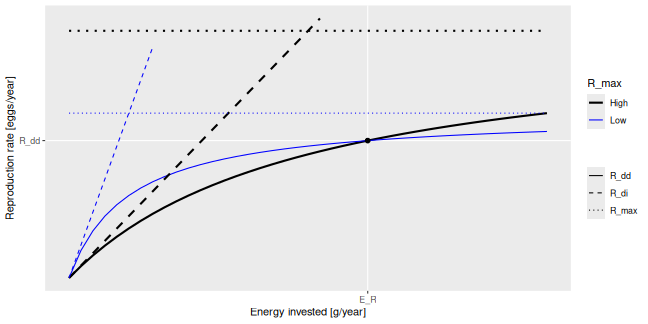

# Alias for `setBevertonHolt()`

**\[superseded\]**

An alias provided for backward compatibility with mizer version \<=
2.0.4

## Usage

``` r
setRmax(
  params,
  erepro,
  R_max,
  reproduction_level,
  info_level = default_info_level(),
  ...
)
```

## Arguments

- params:

  A MizerParams object

- erepro:

  Reproductive efficiency for each species. See details.

- R_max:

  Maximum reproduction rate. See details.

- reproduction_level:

  Sets `R_max` so that the reproduction rate at the initial state is
  `R_max * reproduction_level`.

- info_level:

  Controls the amount of information messages and warnings that are
  shown. Higher levels lead to more messages, `info_level = 0` gives
  silence. The default is taken from the `mizer_info_level` option, see
  [`default_info_level()`](https://sizespectrum.org/mizer/reference/default_info_level.md).

- ...:

  Unused

  - `R_factor`: Legacy alternative for specifying
    `reproduction_level = 1 / R_factor`.

## Value

A MizerParams object

[`reproduction_level()`](https://sizespectrum.org/mizer/reference/setBevertonHolt.md):
A named vector with the reproduction level for each species.

## Details

With Beverton-Holt density dependence the relation between the energy
invested into reproduction and the number of eggs hatched is determined
by two parameters: the reproductive efficiency `erepro` and the maximum
reproduction rate `R_max`.

If no maximum is imposed on the reproduction rate (\\R\_{max} =
\infty\\) then the resulting density-independent reproduction rate
\\R\_{di}\\ is proportional to the total rate \\E_R\\ at which energy is
invested into reproduction, \$\$R\_{di} = \frac{\rm{erepro}}{2 w\_{min}}
E_R,\$\$ where the proportionality factor is given by the reproductive
efficiency `erepro` divided by the egg size `w_min` to convert energy to
egg number and divided by 2 to account for the two sexes.

Imposing a finite maximum reproduction rate \\R\_{max}\\ leads to a
non-linear relationship between energy invested and eggs hatched. This
density-dependent reproduction rate \\R\_{dd}\\ is given as \$\$R\_{dd}
= R\_{di} \frac{R\_{max}}{R\_{di} + R\_{max}}.\$\$

(All quantities in the above equations are species-specific but we
dropped the species index for simplicity.)

The following plot illustrates the Beverton-Holt density dependence in
the reproduction rate for two different choices of parameters.


This plot shows that a given energy \\E_R\\ invested into reproduction
can lead to the same reproduction rate \\R\_{dd}\\ with different
choices of the parameters `R_max` and `erepro`. `R_max` determines the
asymptote of the curve and `erepro` its initial slope. A higher `R_max`
coupled with a lower `erepro` (black curves) can give the same value as
a lower `R_max` coupled with a higher `erepro` (blue curves).

For the given initial state in the MizerParams object `params` one can
calculate the energy \\E_R\\ invested into reproduction and the current
effective recruitment \\R\_{dd}\\. These two values determine the
location of the black dot in the above graph. You then only need one
parameter to select one curve from the family of Beverton-Holt curves
going through that point. This parameter can be `erepro` or `R_max`.
Instead of `R_max` you can alternatively specify the
`reproduction_level` which is the ratio between the density-dependent
reproduction rate \\R\_{dd}\\ and the maximal reproduction rate
\\R\_{max}\\.

If you do not provide a value for any of the reproduction parameter
arguments, then `erepro` will be set to the value it has in the current
species parameter data frame. If you do provide one of the reproduction
parameters, this can be either a vector with one value for each species,
or a named vector where the names determine which species are affected,
or a single unnamed value that is then used for all species. Any species
for which the given value is `NA` will remain unaffected.

The values for `R_max` must be larger than \\R\_{dd}\\ and can range up
to `Inf`. An infeasible requested value is an error.

The values for the `reproduction_level` must be non-negative and less
than 1. The values for `erepro` must be large enough to allow the
preserved recruitment rate. A smaller requested value is an error. The
values for `erepro` should also be smaller than 1 to be physiologically
sensible, but this is not enforced by the function.

A species that is absent from the initial state, with zero abundance at
all sizes, has no reproduction whatever its parameters, so every
Beverton-Holt curve keeps it at its steady state. For such a species a
given `erepro` or `R_max` is used as it is and the other parameter is
left unchanged. Its reproduction level is zero whatever its `R_max`, so
a non-zero `reproduction_level` cannot be set for it and is rejected.

As can be seen in the graph above, choosing a lower value for `R_max` or
a higher value for `erepro` means that near the steady state the
reproduction will be less sensitive to a change in the energy invested
into reproduction and hence less sensitive to changes in the spawning
stock biomass or its energy income. As a result the species will also be
less sensitive to fishing, leading to a higher F_MSY.

## Examples

``` r
params <- NS_params
species_params(params)$erepro
#>   Sprat Sandeel  N.pout Herring     Dab Whiting    Sole Gurnard  Plaice Haddock 
#>       1       1       1       1       1       1       1       1       1       1 
#>     Cod  Saithe 
#>       1       1 
# Increase efficiency while preserving recruitment
params <- setBevertonHolt(params,
    erepro = 2 * species_params(params)$erepro
)
#> Warning: ! The following species require an unrealistic value greater than 1 for `erepro`: Sprat
#> ! The following species require an unrealistic value greater than 1 for `erepro`: Sandeel
#> ! The following species require an unrealistic value greater than 1 for `erepro`: N.pout
#> ! The following species require an unrealistic value greater than 1 for `erepro`: Herring
#> ! The following species require an unrealistic value greater than 1 for `erepro`: Dab
#> ! The following species require an unrealistic value greater than 1 for `erepro`: Whiting
#> ! The following species require an unrealistic value greater than 1 for `erepro`: Sole
#> ! The following species require an unrealistic value greater than 1 for `erepro`: Gurnard
#> ! The following species require an unrealistic value greater than 1 for `erepro`: Plaice
#> ! The following species require an unrealistic value greater than 1 for `erepro`: Haddock
#> ! The following species require an unrealistic value greater than 1 for `erepro`: Cod
#> ! The following species require an unrealistic value greater than 1 for `erepro`: Saithe
t(species_params(params)[, c("erepro", "R_max")])
#>               Sprat      Sandeel       N.pout      Herring         Dab
#> erepro            2            2 2.000000e+00 2.000000e+00           2
#> R_max  734568053068 409973456848 1.010954e+13 1.105535e+12 11176346947
#>             Whiting        Sole     Gurnard       Plaice      Haddock
#> erepro            2           2 2.00000e+00 2.000000e+00 2.000000e+00
#> R_max  544466527832 38630947185 1.01135e+12 6.059906e+13 1.787419e+12
#>               Cod       Saithe
#> erepro          2            2
#> R_max  8259738057 111869833966
# Setting erepro for some species
params <- setBevertonHolt(params, reproduction_level = c(Gurnard = 0.6))
#> Warning: The following species require an unrealistic value greater than 1 for `erepro`: Gurnard
t(species_params(params)[, c("erepro", "R_max")])
#>               Sprat      Sandeel       N.pout      Herring         Dab
#> erepro            2            2 2.000000e+00 2.000000e+00           2
#> R_max  734568053068 409973456848 1.010954e+13 1.105535e+12 11176346947
#>             Whiting        Sole      Gurnard       Plaice      Haddock
#> erepro            2           2 1.395255e+00 2.000000e+00 2.000000e+00
#> R_max  544466527832 38630947185 1.215220e+12 6.059906e+13 1.787419e+12
#>               Cod       Saithe
#> erepro          2            2
#> R_max  8259738057 111869833966
# Setting R_max
R_max <- 2 * getRDD(params)
params <- setBevertonHolt(NS_params, R_max = R_max)
#> Warning: ! The following species require an unrealistic value greater than 1 for `erepro`: Gurnard
#> ! The following species require an unrealistic value greater than 1 for `erepro`: Plaice
t(species_params(params)[, c("erepro", "R_max")])
#>               Sprat      Sandeel       N.pout      Herring          Dab
#> erepro 1.851524e-02 2.589408e-04 1.434136e-01 1.602395e-02 8.429716e-03
#> R_max  1.462336e+12 8.198938e+11 1.949416e+13 2.202213e+12 2.230559e+10
#>             Whiting         Sole      Gurnard       Plaice      Haddock
#> erepro 2.562653e-02 7.124529e-03 1.116204e+00 1.839558e+00 1.111311e-01
#> R_max  1.081957e+12 7.712428e+10 1.458264e+12 6.546038e+13 3.475519e+12
#>                 Cod       Saithe
#> erepro 1.268449e-04 4.643390e-03
#> R_max  1.651895e+10 2.234799e+11
# Setting reproduction_level
params <- setBevertonHolt(params, reproduction_level = 0.3)
#> Warning: The following species require an unrealistic value greater than 1 for `erepro`: Plaice
t(species_params(params)[, c("erepro", "R_max")])
#>               Sprat      Sandeel       N.pout      Herring          Dab
#> erepro 1.322517e-02 1.849577e-04 1.024383e-01 1.144568e-02 6.021226e-03
#> R_max  2.437226e+12 1.366490e+12 3.249026e+13 3.670356e+12 3.717598e+10
#>             Whiting         Sole      Gurnard       Plaice      Haddock
#> erepro 1.830466e-02 5.088950e-03 7.972884e-01 1.313970e+00 7.937939e-02
#> R_max  1.803261e+12 1.285405e+11 2.430440e+12 1.091006e+14 5.792531e+12
#>                 Cod       Saithe
#> erepro 9.060350e-05 3.316707e-03
#> R_max  2.753159e+10 3.724666e+11

# Inspecting reproduction level
reproduction_level(NS_params)
#>      Sprat    Sandeel     N.pout    Herring        Dab    Whiting       Sole 
#> 0.99074238 0.99987053 0.92829319 0.99198802 0.99578514 0.98718674 0.99643774 
#>    Gurnard     Plaice    Haddock        Cod     Saithe 
#> 0.44189813 0.08022106 0.94443443 0.99993658 0.99767830 

# The reproduction level can be changed without changing the steady state:
reproduction_level(params) <- 0.9
#> Warning: ! The following species require an unrealistic value greater than 1 for `erepro`: Gurnard
#> ! The following species require an unrealistic value greater than 1 for `erepro`: Plaice
reproduction_level(params)
#>   Sprat Sandeel  N.pout Herring     Dab Whiting    Sole Gurnard  Plaice Haddock 
#>     0.9     0.9     0.9     0.9     0.9     0.9     0.9     0.9     0.9     0.9 
#>     Cod  Saithe 
#>     0.9     0.9 
```
